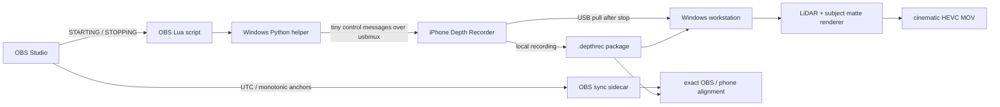

# Depth Recorder

**LiDAR-assisted cinematic video for iPhone 12 Pro Max, with OBS-controlled recording, absolute UTC timestamps, USB transfer, and Windows post-processing.**

> Experimental project. Tested on an iPhone 12 Pro Max (`iPhone13,4`) and a Windows recording workstation. Current source version: **0.7.2 (build 11)**.

**Validation status:** the 26 mm 4K RGB-D/LiDAR path, UTC recording package, USB transfer, renderer, and OBS script loading have been exercised on the development system. Build 11 replaces the earlier 13/65 switching approach with direct physical ultra-wide/telephoto sessions; that specific lens-switch change is build-validated and should be treated as experimental until the current IPA is re-sideloaded and exercised on-device.


Depth Recorder is built around one simple idea: **record the best source on the phone, synchronize it precisely with OBS, and do the expensive cinematic processing later.**

The iPhone 12 Pro Max predates Apple's Cinematic Mode, but it has a rear LiDAR scanner. In the 26 mm rear-camera mode, Depth Recorder records a clean high-resolution RGB master together with synchronized metric depth. A Windows renderer then combines LiDAR geometry with a human matte to create a subtle, bidirectional depth-of-field effect: objects in front of the subject and behind the subject can both fall out of focus naturally.

The OBS integration does not stream the 4K master through OBS. OBS only sends start/stop commands and captures timing anchors. The full-quality recording stays on the iPhone and is copied over USB after recording stops.

## What it does

- Records a clean local iPhone master instead of using a high-latency 4K live stream.
- Captures synchronized RGB + metric LiDAR depth on the 26 mm rear camera.
- Supports real physical rear-camera switching:
  - **13 mm ultra-wide:** RGB only; LiDAR/DOF disabled.
  - **26 mm main/LiDAR:** RGB + LiDAR; cinematic post-processing available.
  - **65 mm telephoto:** RGB only; LiDAR/DOF disabled.
- Supports optional phone audio. OBS/laptop audio can remain the production microphone.
- Provides manual camera controls including ISO, shutter, exposure compensation, focus, white balance, tint, torch, and zoom.
- Supports tap-to-focus and press-and-hold **AE/AF/WB Lock**.
- Records per-frame Unix UTC nanoseconds from the capture clock.
- Starts/stops the iPhone recorder when OBS recording starts/stops.
- Pulls the finished take from the phone over USB after finalization.
- Generates OBS/phone synchronization sidecars with the exact timeline offset.
- Renders subtle foreground + background defocus without baking blur into the camera master.

## Architecture



The important design decision is that **video transport is not in the critical recording path**. USB is used for lightweight control and post-recording transfer, not for the full-quality 4K master during capture.

For implementation details, see [`docs/ARCHITECTURE.md`](docs/ARCHITECTURE.md).

## Current capture modes

| UI | Physical camera | Depth | Cinematic renderer | Intended use |
|---|---|---:|---:|---|
| **13 mm** | Ultra-wide | No | No | Wide establishing / room shots |
| **26 mm** | Main + LiDAR | Yes | Yes | Primary cinematic talking-head mode |
| **65 mm** | Telephoto | No | No | Tight RGB-only shots |

The 26 mm path has been validated at **3840x2160 / ~30 fps** with synchronized LiDAR depth. Full-sensor 4:3 capture is also available in settings when supported by the selected format.

## Recording package

Each take is stored on the phone as:

```text
<timestamp>_<id>.depthrec/
|-- master.mov
|-- depth.bin
|-- frames.jsonl
|-- calibration.json
`-- manifest.json
```

For RGB-only 13/65 mm takes, `manifest.json` records `depth_available=false`; depth-dependent post-processing is intentionally skipped.

The authoritative synchronization value is the per-frame **Unix UTC nanosecond timestamp**. QuickTime/SMPTE timecode is generated for editor compatibility, but UTC remains the source of truth.

The binary format is documented in [`RECORDING_FORMAT.md`](RECORDING_FORMAT.md).

## Requirements

### iPhone

- iPhone 12 Pro Max is the primary tested target.
- Developer Mode enabled.
- USB data connection to Windows.
- The app must be sideloaded; App Store distribution is not required.

### Windows

- Windows 10/11.
- Apple USB/device drivers. The modern **Apple Devices** app is sufficient for the tested USB stack.
- Python 3.
- `pymobiledevice3` for usbmux, app discovery, launch, and House Arrest transfer.
- OBS Studio for OBS-controlled recording.
- MSYS2 + Theos/TheosWin for building the iOS app on Windows.
- FFmpeg/ffprobe for the post pipeline.
- Current production renderer: NVIDIA GPU with an FFmpeg build that supports **NVENC** and **Vulkan** filters.

## Quick start

### 1. Clone

```powershell
git clone https://github.com/DevDeepakBhattarai/iPhoneDepthRecorder.git
cd iPhoneDepthRecorder
```

### 2. Create the Python environment

```powershell
py -3 -m venv .venv
.\.venv\Scripts\python.exe -m pip install --upgrade pip
.\.venv\Scripts\python.exe -m pip install -r requirements.txt
```

### 3. Download the subject-segmentation model

Model weights are not stored in this repository.

```powershell
.\tools\download-model.ps1
```

The downloader retrieves `u2net_human_seg.onnx` from the rembg model release and verifies this SHA-256 before accepting it:

```text
01EB6A29A5C4D8EDB30B56ADAD9BB3A2A0535338E480724A213E0ACFD2D1C73C
```

### 4. Install the Windows iOS build toolchain

The default build script expects:

```text
C:\msys64\usr\bin\bash.exe
%USERPROFILE%\.theos\theos
```

If your paths differ, pass them explicitly:

```powershell
.\build.ps1 -MsysBash "C:\path\to\bash.exe" -TheosRoot "C:\path\to\theos"
```

### 5. Build the unsigned IPA

```powershell
.\build.ps1
```

Output:

```text
DepthRecorder-unsigned.ipa
```

The IPA is deliberately ignored by Git. Signing/provisioning is kept outside the repository.

## Sideload with Sideloadly

The tested installation workflow uses **Sideloadly** on Windows.

1. Download Sideloadly from its official site: https://sideloadly.io/
2. Connect and unlock the iPhone over USB.
3. Drag `DepthRecorder-unsigned.ipa` into Sideloadly.
4. Enter your Apple ID **in Sideloadly itself** when prompted.
5. Complete 2FA if Apple requests it.
6. Install the app, enable Developer Mode if necessary, and trust/approve the developer profile when iOS asks.

This repository does **not** read, store, log, or ship your Apple ID password, 2FA codes, signing certificate, provisioning profile, or Sideloadly state. With free Apple provisioning, the sideloaded app may need to be refreshed periodically (commonly every seven days).

## Camera workflow

For the intended cinematic path:

1. Select **26 mm**.
2. Frame the subject.
3. Tap to focus/expose, or press and hold to settle and lock **AE/AF/WB**.
4. Optionally set manual ISO/shutter/white balance.
5. Start recording manually or let OBS start it.
6. Keep the source clean; the live DOF preview is only a preview.
7. Render the final DOF effect on Windows after capture.

Switching to **13 mm** or **65 mm** intentionally disables LiDAR and the live DOF control. Returning to **26 mm** rebuilds the capture session with LiDAR again.

## OBS integration

The OBS script controls recording without sending the 4K master through OBS.

### Install

```powershell
.\install-obs.ps1
```

Then in OBS:

1. Open **Tools -> Scripts**.
2. Click **+**.
3. Add:

```text
%APPDATA%\obs-studio\scripts\DepthRecorder\depth-recorder-sync.lua
```

Keep the phone connected over USB. For the most reliable first run, unlock the phone and open Depth Recorder once. The helper can also attempt to launch the app through `pymobiledevice3` when Developer Mode services are available.

### What happens when OBS records

**OBS Recording Starting**

- records an OBS monotonic-clock anchor;
- maps that anchor to Unix UTC;
- sends `start_record` over usbmux;
- the iPhone records locally.

**OBS Recording Stopping / Stopped**

- sends `stop_record`;
- waits for the iPhone writer to finish;
- pulls the newest `.depthrec` package read-only;
- writes `obs_sync.json` and an OBS-side `.depthrec-sync.json`;
- optionally starts the cinematic renderer.

By default, runtime data is stored under:

```text
%USERPROFILE%\Videos\DepthRecorder\
|-- device-captures\
`-- obs-sync\
```

Override it with:

```powershell
$env:DEPTHRECORDER_DATA_ROOT = 'D:\MyCaptureRoot'
```

## Manual USB transfer

List recordings without copying anything:

```powershell
.\pull-latest.ps1 --list
```

Pull the newest take:

```powershell
.\pull-latest.ps1
```

Pull and render the newest LiDAR take:

```powershell
.\pull-and-render.ps1
```

The transfer path is intentionally read-only with respect to phone recordings. If the destination already exists, the tool creates a distinct copy instead of overwriting it.

## Cinematic renderer

The production renderer is:

```text
tools/render_natural_dof.py
```

Its goal is **subtle lens-like focus falloff**, not background replacement.

Pipeline:

1. decode the clean RGB master without auto-rotating sensor coordinates;
2. read metric Float16 LiDAR depth;
3. interpolate/smooth rare missing depth frames;
4. generate a person matte with U2Net;
5. stabilize the matte temporally with optical flow;
6. fuse the matte with LiDAR so segmentation does not redefine scene geometry;
7. derive a stable subject/focus plane;
8. apply gentle blur both **in front of** and **behind** the focus plane;
9. feather the subject edge to avoid halos/cutout artifacts;
10. encode HEVC and stamp UTC-derived QuickTime timecode.

Render one take:

```powershell
.\postprocess-take.ps1 -Package "C:\path\to\take.depthrec"
```

Quick 30-frame test:

```powershell
.\postprocess-take.ps1 -Package "C:\path\to\take.depthrec" -Limit 30
```

Process every local capture:

```powershell
.\postprocess-all.ps1
```

RGB-only 13/65 mm takes are preserved and validated, but the LiDAR cinematic pass is skipped because those modes intentionally do not record depth.

## Exact OBS alignment

For an OBS-controlled take:

```powershell
.\.venv\Scripts\python.exe .\tools\sync_report.py "C:\path\to\take.depthrec"
```

The resulting `alignment.json` contains the exact phone-vs-OBS offset derived from UTC anchors. Start/stop commands do not have to land on the same frame for the clips to align correctly in post.

## Diagnostics

Validate a recording package:

```powershell
.\.venv\Scripts\python.exe .\tools\inspect_recording.py "C:\path\to\take.depthrec" --sample-depth
```

Stamp editor-compatible timecode without re-encoding the source master:

```powershell
.\.venv\Scripts\python.exe .\tools\stamp_timecode.py "C:\path\to\take.depthrec"
```

## Project layout

```text
.
|-- CaptureEngine.*                 AVFoundation capture + camera control
|-- RecordingSession.*              MOV/depth/UTC package writer
|-- PreviewRenderer.*               disposable live DOF preview
|-- RecorderViewController.*        camera UI
|-- RemoteControlServer.*           USB-mux control endpoint
|-- obs/                             OBS Lua + launcher
|-- tools/                           transfer, sync, inspect, render utilities
|-- RECORDING_FORMAT.md              .depthrec format specification
|-- THIRD_PARTY_NOTICES.md           upstream provenance/licenses
|-- build.ps1                        Windows/Theos build
|-- install-obs.ps1                  OBS script installer
`-- requirements.txt                 Python dependencies
```

## Security and privacy

- No Apple credentials belong in this repository.
- No provisioning profiles, signing certificates, model weights, recordings, IPAs, build products, or OBS runtime logs are committed.
- The phone control service is for the local USB-mux workflow; the 4K master is never sent through the control socket.
- Transfer tooling has no phone-side delete operation.
- Treat `.depthrec` recordings and OBS sidecars as private media: they can contain timestamps, camera metadata, file paths, and recorded audio/video.

See [`SECURITY.md`](SECURITY.md) before attaching logs to public issues.

## Current limitations

- Primary tested hardware is iPhone 12 Pro Max.
- LiDAR cinematic rendering is available on the 26 mm path; 13/65 mm are RGB-only by design.
- The production renderer currently assumes an NVIDIA NVENC/Vulkan-capable FFmpeg build.
- This is an experimental camera pipeline, not an Apple Cinematic Mode implementation and not an Apple product.
- Free sideloading requires periodic reprovisioning.

## License and upstream work

Depth Recorder is released under **GPL-2.0-or-later**. See [`LICENSE`](LICENSE) and [`THIRD_PARTY_NOTICES.md`](THIRD_PARTY_NOTICES.md).

LensLink materially informed the camera-control interaction model and USB/OBS architecture. The current recorder keeps a separate capture-first RGB-D design and intentionally avoids using a high-latency full-quality streaming path as the master recording.
